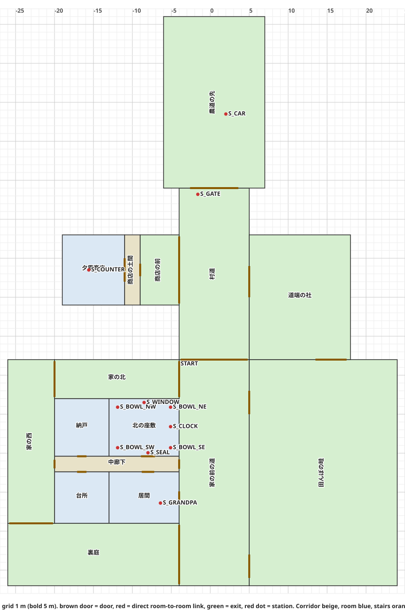

# Floor plan

Generated by tools/plan-doc.mjs from the plan JSON. Do not edit by hand.

## Check

16 rooms, 20 doors, 0 direct room links. 0 error(s), 0 warning(s).

## Rooms

| id | name | kind | floor | x | z | size (m) |
|---|---|---|---|---|---|---|
| NANDO | 納戸 | room | 0 | -20 | 3 | 7 x 7.4 |
| ZASHIKI | 北の座敷 | room | 0 | -13 | 3 | 9 x 7.4 |
| ROUKA | 中廊下 | corridor | 0 | -20 | 10.4 | 16 x 2 |
| DAIDOKORO | 台所 | room | 0 | -20 | 12.4 | 7 x 6.6 |
| IMA | 居間 | room | 0 | -13 | 12.4 | 9 x 6.6 |
| SHOP | 夕霧商店 | room | 0 | -19 | -18 | 8 x 9 |
| SHOP_DOMA | 商店の土間 | corridor | 0 | -11 | -18 | 2 x 9 |
| O_FRONT | 家の前の道 | outdoor | 0 | -4 | -2 | 9 x 29 |
| O_GARDEN | 裏庭 | outdoor | 0 | -26 | 19 | 22 x 8 |
| O_BACK | 家の西 | outdoor | 0 | -26 | -2 | 6 x 21 |
| O_NORTH | 家の北 | outdoor | 0 | -20 | -2 | 16 x 5 |
| O_FIELD | 田んぼの畦 | outdoor | 0 | 5 | -2 | 19 x 29 |
| O_ROAD | 村道 | outdoor | 0 | -4 | -24 | 9 x 22 |
| O_SHOPFRONT | 商店の前 | outdoor | 0 | -9 | -18 | 5 x 9 |
| O_SHRINE | 道端の社 | outdoor | 0 | 5 | -18 | 13 x 16 |
| O_GATE | 農道の先 | outdoor | 0 | -6 | -46 | 13 x 22 |

## Doors

| id | from | to | width (m) | kind | note |
|---|---|---|---|---|---|
| D_GENKAN | IMA 居間 | O_FRONT 家の前の道 | 1.4 | door |  |
| D_IMA | IMA 居間 | ROUKA 中廊下 | 1.6 | door |  |
| D_KATTE | ROUKA 中廊下 | O_BACK 家の西 | 1.1 | door |  |
| D_ENGAWA | ROUKA 中廊下 | O_FRONT 家の前の道 | 1.2 | door |  |
| D_DAIDOKORO | DAIDOKORO 台所 | ROUKA 中廊下 | 1.2 | door |  |
| D_NANDO | NANDO 納戸 | ROUKA 中廊下 | 1.2 | door |  |
| D_FUSUMA | ZASHIKI 北の座敷 | ROUKA 中廊下 | 1.8 | door |  |
| D_SHOP | SHOP_DOMA 商店の土間 | O_SHOPFRONT 商店の前 | 1.6 | door |  |
| G_SHOP_DOMA | SHOP 夕霧商店 | SHOP_DOMA 商店の土間 | 3 | door |  |
| G_FRONT_GARDEN | O_FRONT 家の前の道 | O_GARDEN 裏庭 | 7.6 | door |  |
| G_GARDEN_BACK | O_GARDEN 裏庭 | O_BACK 家の西 | 5.6 | door |  |
| G_BACK_NORTH | O_BACK 家の西 | O_NORTH 家の北 | 4.6 | door |  |
| G_NORTH_FRONT | O_NORTH 家の北 | O_FRONT 家の前の道 | 4.6 | door |  |
| G_FRONT_FIELD | O_FRONT 家の前の道 | O_FIELD 田んぼの畦 | 3 | door |  |
| G_FRONT_FIELD2 | O_FRONT 家の前の道 | O_FIELD 田んぼの畦 | 3 | door |  |
| G_FRONT_ROAD | O_FRONT 家の前の道 | O_ROAD 村道 | 8.6 | door |  |
| G_ROAD_SHOPFRONT | O_ROAD 村道 | O_SHOPFRONT 商店の前 | 8.6 | door |  |
| G_ROAD_SHRINE | O_ROAD 村道 | O_SHRINE 道端の社 | 4 | door |  |
| G_SHRINE_FIELD | O_SHRINE 道端の社 | O_FIELD 田んぼの畦 | 4 | door |  |
| D_GATE | O_ROAD 村道 | O_GATE 農道の先 | 6.2 | door |  |

## Stations

| id | room | x | z |
|---|---|---|---|
| S_COUNTER | SHOP 夕霧商店 | -15.6 | -13.5 |
| S_GRANDPA | IMA 居間 | -6.4 | 16.4 |
| S_BOWL_NW | ZASHIKI 北の座敷 | -11.9 | 4.1 |
| S_BOWL_NE | ZASHIKI 北の座敷 | -5.1 | 4.1 |
| S_BOWL_SW | ZASHIKI 北の座敷 | -11.9 | 9.3 |
| S_BOWL_SE | ZASHIKI 北の座敷 | -5.1 | 9.3 |
| S_WINDOW | ZASHIKI 北の座敷 | -8.5 | 3.5 |
| S_SEAL | ZASHIKI 北の座敷 | -8 | 9.95 |
| S_CLOCK | ZASHIKI 北の座敷 | -5.1 | 6.6 |
| S_GATE | O_ROAD 村道 | -1.6 | -23.2 |
| S_CAR | O_GATE 農道の先 | 2 | -33.5 |

## Routes

- village_loop: O_ROAD > O_SHRINE > O_FIELD > O_FRONT > O_ROAD
